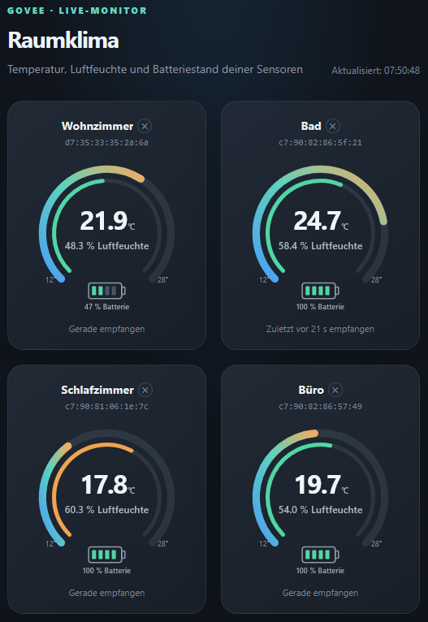

# Govee to MQTT (ESP32)

An ESP32 starter project that scans for nearby Govee Bluetooth advertisements and publishes valid temperature data telegrams from H5104 and H5110 sensors to MQTT, along with decoded readings. Other advertisements and unsupported models are ignored. It uses PlatformIO with the Arduino framework.

## Requirements

- An ESP32 development board supported by PlatformIO's `esp32dev` board definition
- Visual Studio Code with the PlatformIO extension, or PlatformIO Core
- A reachable MQTT broker

## Configure

1. Copy `include/secrets.h.example` to `include/secrets.h`.
2. Set your Wi-Fi and MQTT broker credentials in `include/secrets.h`.
3. Set `OTA_PASSWORD` to a unique password. OTA is disabled when this value is empty.
4. Set `GOVEE_NAME_PREFIX` to the prefix in your device's Bluetooth advertised name. The default is `GVH`.
5. Build and upload the `esp32dev` environment over USB.

The local `include/secrets.h` file is ignored by Git.

## OTA updates

The ESP32 uses the Wi-Fi hostname `govee-gw`, which should appear as its host name in the router's DHCP client list. The web dashboard is available at `http://govee-gw.local/` when mDNS works on your network; the serial monitor also prints the assigned IP address and dashboard URL. If `.local` does not resolve, use the IP address shown in the serial monitor or router.

The firmware enables password-protected ArduinoOTA after connecting to Wi-Fi; the OTA service listens on port `3232`. Keep the device and your computer on a trusted local network; ArduinoOTA does not encrypt the firmware transfer.

For PlatformIO uploads, select the `esp32dev_ota` environment. PlatformIO reads the OTA password from your local, Git-ignored `include/secrets.h`, so no environment variable is needed. In VS Code, open **PlatformIO: Project Tasks → esp32dev_ota → General → Upload**. If `govee-gw.local` does not resolve, set `upload_port` in `platformio.ini` to the ESP32's current IP address. USB uploads remain available through the normal `esp32dev` environment.

## MQTT output

Matching advertisements are published as retained JSON messages to:

```text
govee/raw/<bluetooth-address>
```

Example payload:

```json
{
  "name": "GVH5104_1234",
  "address": "aa:bb:cc:dd:ee:ff",
  "alias": "Wohnzimmer",
  "rssi": -62,
  "sensors": {
    "temperature_c": 23.3,
    "humidity_percent": 21.4,
    "battery_percent": 100
  }
}
```

`alias` contains the sensor's configured dashboard alias, or an empty string if no alias is set. Alias changes are included in the next message published for that sensor. Messages are published only for H5104 and H5110 advertisements containing a valid temperature, humidity, and battery reading. The `sensors` object's temperature is in Celsius; humidity and battery are percentages. Non-data advertisements, invalid readings, and unsupported models are not published.

## Web dashboard

When the ESP32 is connected to Wi-Fi, open its IP address in a browser to view the live sensor dashboard. The page shows one combined gauge per sensor: temperature on the outer ring (12–28 °C), humidity on the inner ring (green from 40–60%, orange otherwise), and a four-block battery indicator. Readings refresh every five seconds. Tap a sensor name to set an alias (up to 20 characters); the `×` button removes it. Up to eight aliases are stored persistently in ESP32 NVS and remain available after reboot. Sensors remain listed with their last readings for the entire current boot, even if they stop transmitting; the page shows when each sensor was last heard. The sensor list itself resets when the ESP32 reboots. Sensor scanning and the dashboard continue to work if the MQTT broker is temporarily unavailable.

### Standalone MQTT dashboard

The project also includes [mqtt-dashboard.html](./mqtt-dashboard.html), a separate dashboard that uses the same visual design but reads sensor values directly from the MQTT broker over WebSockets. It does not allow aliases to be edited. Open the file in a browser after setting `MQTT_CONFIG` near the top of the file: enter the broker host, its WebSocket port and path, TLS setting, optional credentials, and topic. The broker must have an MQTT-over-WebSocket listener enabled; the default port and path in the file are examples and may need to match your broker. If the broker restricts WebSocket origins, serve the HTML from a local web server instead of opening it as a `file://` URL.

The page loads the MQTT.js browser library from a CDN, so it needs internet access to load that script. Broker credentials entered in the HTML are visible to anyone who can access the file; use a read-only MQTT account and prefer TLS (`wss`) when supported.

### Screenshot



## Notes

- Version 1 completely vibecoded !
- This project scans for devices whose advertised name starts with `GOVEE_NAME_PREFIX`.
- Some Govee models may use a different name prefix or may not expose a name in their advertisements. Adjust `isGoveeAdvertisement()` in `src/main.cpp` to match your device.
- The default MQTT port is `1883`. Configure credentials if your broker requires authentication.
